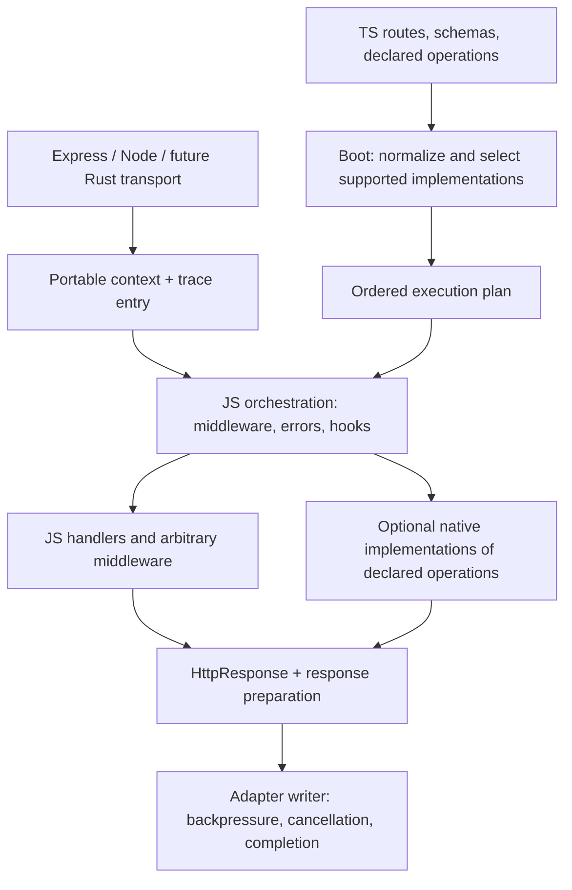

# Astro Proposal

**Date:** 2026-11-01. **Status:** proposal for review, not an approved runtime contract.
**Baseline:** `ccr-80ccfb40-0qs0lo` at `c18d732d5be812dbb1a6638974147c158b073f09`.
**Scope:** middleware execution, request context, observability, and a compatible path to native
transport/validation capabilities. No production implementation is included in this change.

This revisits [D1/D2.1](../queued/async-middleware.md), the
[existing options](middleware-design-proposals.md), and the
[native engine spike](../queued/http-engine-spike.md). The owner now permits explicit
`return next()` in ordinary middleware and substantial redesign. The old requirement that
BEFORE-only middleware must not mention `next` is therefore no longer a constraint for this
proposal. Earlier reviewer recommendations made under that constraint remain historical evidence.

## Recommendation and the remaining disagreement

Astro recommends **one explicit response-returning onion contract**, with a framework request
context and separate response-preparation/completion lifecycle points. Do not adopt B's
auto-continue/forgotten-return rules. Keep **H (explicit stages plus explicit wrappers)** as the
serious alternative if its memory advantage justifies two execution contracts in representative
applications. Neither model should dictate whether the transport or selected operations use Rust.

An independent GPT-6.1 Sol review prefers **H**, because ordinary request stages can finish and
release their frames before the handler waits. Sol agrees that strict onion is the simpler public
API, that the old B benchmark does not measure it, and that small production differences would
weaken H's justification. This is an actual disagreement about the simplicity/memory trade-off,
not disagreement about ALS or tracing correctness. See the evidence and decision gate below.

Shared conclusions:

- Framework-owned ALS and full framework tracing work with either model.
- An application's own ALS/span scope around subsequent middleware needs a real continuation.
- Raw errors must unwind application wrappers before registry normalization if ordinary
  `try/catch/finally` semantics are promised.
- A handler returning a response descriptor and a transport finishing that response are different
  events. Streams make this distinction unavoidable.
- Interfaces make implementations replaceable; they do not make arbitrary JavaScript compilable
  to Rust. Native optimization needs an explicitly representable operation and equivalent behavior.

## What is already implemented on this branch

The [P1q response bridge](../active/universal-http-responses.md) is real: `responses.ts`,
`ExpressResponseWriter`, framework error descriptors, and the `transformResponse` Server option
exist. The adapter awaits the handler, then writes its returned descriptor.

The middleware loop in `ExpressAdapter.ts` still uses the v1 callback bridge. The controller
wrapper in `controllers/index.ts` still catches validation/handler errors and returns their
registry responses. Merely adding an awaitable `next` outside that wrapper would not make errors
observable by a transaction wrapper. This boundary must deliberately change for v2 execution;
the existing v1 bridge must remain compatible during v5.

`RequestContext` is still a proposed interface. Reusing the Express request in v5 can avoid an
extra wrapper object, but portability needs executable conformance, not a type assertion. For
example, Express `req.route` is an object, whereas the proposal calls `ctx.route` a string; a new
portable field such as `routeTemplate` avoids overwriting legacy semantics. Lazy properties must
also avoid collisions with Express's existing `path`, `url`, `query`, and header APIs.

## Primary-source comparison

| Project                                                                                                                                                                | Relevant behavior                                                                                                                                                                                                                                     | Lesson for this decision                                                                                                     |
| ---------------------------------------------------------------------------------------------------------------------------------------------------------------------- | ----------------------------------------------------------------------------------------------------------------------------------------------------------------------------------------------------------------------------------------------------- | ---------------------------------------------------------------------------------------------------------------------------- |
| [Koa](https://github.com/koajs/koa/blob/f2ec5f1607cda5dc87d0df6c435b386180b1b45e/lib/application.js)                                                                   | Composes middleware, enters request ALS, handles uncaught errors outside the chain, writes after the chain resolves.                                                                                                                                  | Ordinary onion already supplies lexical wrapping. It need not wait through streaming.                                        |
| [Hono](https://github.com/honojs/hono/blob/c91b60a251186fb024557c6d55a11d8e388f179c/src/compose.ts)                                                                    | Onion dispatch normally converts downstream `Error`s inside the chain. Its [context-storage middleware](https://github.com/honojs/hono/blob/c91b60a251186fb024557c6d55a11d8e388f179c/src/middleware/context-storage/index.ts) uses ALS around `next`. | Flow and error policy are independent decisions; do not infer rollback semantics from the word onion.                        |
| [AdonisJS](https://github.com/adonisjs/http-server/blob/0801ec2d7480a9610bd4063da24a82633fc2674a/src/server/main.ts)                                                   | Uses middleware wrapping, request ALS, tracing channels, and a separate response-completion notification.                                                                                                                                             | These facilities coexist without introducing a second business middleware API.                                               |
| [Fastify lifecycle](https://fastify.dev/docs/latest/Reference/Lifecycle/) and [request-context](https://github.com/fastify/fastify-request-context/blob/main/index.js) | Uses stages; its context plugin explicitly enters/restores ALS across continuations.                                                                                                                                                                  | Stages support ambient context and tracing. An arbitrary middleware-created scope does not automatically cover later stages. |
| [h3 current source](https://github.com/h3js/h3/blob/main/src/middleware.ts)                                                                                            | Supports optional `next`, auto-continues unhandled values, memoizes continuation results, precomposes chains.                                                                                                                                         | Optional continuation is feasible, but carries additional result/continuation rules. Boot composition is not exclusive to H. |
| [Ajv](https://ajv.js.org/guide/managing-schemas.html)                                                                                                                  | Compiles and reuses schema validators; recommends compilation outside request processing.                                                                                                                                                             | Establish a good precompiled JS control before attributing gains to a native implementation.                                 |

These are source/document observations, not comparative framework performance measurements.
Main-branch links may evolve; pinned links identify the reviewed snapshots where available.

## Proposed middleware contract

The following is a v2 target sketch, not an exported type in this commit:

```ts
type Next = () => Promise<HttpResponse>;
type Middleware = (
  ctx: RequestContext,
  next: Next,
) => HttpResponse | Promise<HttpResponse>;
```

- `return next()` delegates and propagates the response.
- `const response = await next(); ...; return response` performs response-construction work.
- Returning a branded `HttpResponse` without calling `next` short-circuits.
- Throwing rejects the continuation. Use `return await next()` inside `try/finally` when cleanup
  must wait for downstream settlement.
- `void`, a patch object, and a `Next` sentinel are not alternate continuation signals in this
  contract. Runtime failures must identify the offending middleware, rather than hang the request.
- `next` is single-use and expires when the invocation settles. Reject duplicate and late calls.
  A runner must account for already-started downstream work before selecting/writing a response
  after `next(); return otherResponse` or `next(); throw error`. A warning alone is insufficient.
  The production guard and cancellation policy need conformance tests; benchmark kernels do not
  claim to implement those guards.

Ordinary middleware keeps request-local data on the context:

```ts
async middleware(ctx, next) {
  ctx.appInfo.user = await resolveUser(ctx);
  return next();
}
```

An application-owned store needs no special scope registration:

```ts
async middleware(ctx, next) {
  const tenant = await resolveTenant(ctx);
  return tenantStorage.run(tenant, next);
}
```

Returning a patch can express data changes, but cannot itself establish an async execution scope.
General patch merging would also need deletion, collision, validation, and ownership rules. It is
not required to gain native optimization: built-in declarative operations can have internal
serializable plans while arbitrary application middleware remains ordinary JS.

The strict response target cannot silently pretend that legacy `res` handlers return descriptors.
During v5, the bridge needs an explicit internal completed/aborted/legacy outcome or an honest
bridge-specific return type. Full response inspection and transaction guarantees apply to the
descriptor path; writing directly to `res` cannot be rolled back by outer middleware. Settle this
bridge before publishing a v2 type that consumers are expected to keep unchanged in v6.

## Errors, response hooks, transactions, and streams

Proposed normal ordering:

```text
request context / server trace
  -> middleware + validation + handler
  -> wrappers unwind (raw errors can be caught here)
  -> uncaught error registry resolution
  -> per-request beforeSend hooks
  -> existing global transformResponse
  -> writer
  -> exactly-once completion notification
```

`beforeSend` is the single per-request response-preparation hook, if adopted; do not add a second
`onResponse` alias with ambiguous timing. Already-registered hooks run newest first, including
normal short-circuits and registry error responses. A throwing hook is not retried: normalize its
error, then run the remaining hooks once. Freeze registration when preparation starts. The
existing global `transformResponse` retains P1q's policy: report a broken transform and use the
untransformed response.

A writer/serialization failure before headers commit is a separate recovery attempt. Do not
automatically replay application middleware or arbitrary hooks. Preserve request-wide staged
headers, normalize the write error, and use a bounded recovery path; completion observers report
the actual result. After commit, terminate/cancel as needed and report failure; another HTTP
response cannot replace bytes already sent. This intentionally limits any claim that a hook sees
every possible final transport outcome.

A returned 4xx response is a successful function return, not a thrown error. A transaction policy
that rolls back on certain response statuses must say so explicitly. Also, a transaction around
handler execution may commit before response hooks or serialization fail: this is not atomic
delivery of a database transaction and an HTTP response.

**Transaction retries are a separate hazard.** Mongoose's `connection.transaction` delegates to
`withTransaction`, whose callback may be retried. Consequently
`connection.transaction(() => next())` is not a generally safe recipe for a single-use request
chain. Replaying it could repeat nontransactional I/O and hook registration. Use an explicitly
single-execution transaction scope, or put retries inside an isolated, deliberately replayable
business operation. Retrying commit is distinct from rerunning the handler.
[Mongoose](https://mongoosejs.com/docs/transactions.html),
[MongoDB transaction APIs](https://www.mongodb.com/docs/drivers/node/current/crud/transactions/).

A lazy response stream is consumed after the onion unwinds. It must not depend on a transaction
or lock already released by `finally`. Materialize transactional results first, or give the
stream its own explicit resource/cancellation lifetime. Replacing a response must dispose an
unused stream source; consuming/teeing a stream for caching is a separate capability.

`onFinish` means server-side completion, not client acknowledgement. Its proposed outcome is
`finished | aborted | failed`, with optional observed status/error and clearly defined duration
and byte counts. Register listeners early, settle exactly once across finish/close/error races,
and contain callback failures. An aborted transport does not magically cancel arbitrary JS or DB
work: expose an AbortSignal and require cooperative cancellation. End request-execution scopes
only after their work has unwound. Never await `onFinish` inside middleware that must first return
the descriptor to start the writer.
[Node ServerResponse semantics](https://nodejs.org/api/http.html#class-httpserverresponse).

## ALS and observable execution

Use one framework ALS instance, with a distinct context/store per request. It may reuse the
existing context rather than copy its body and state. An imported `requestContext()` accessor is
a convenience beside explicit `ctx`; it does not replace typed route-local `appInfo`.

Request context must be active across dispatch, error resolution, response preparation, writer
callbacks, and completion observers. An ordinary event listener does not automatically capture
its registration context. Specify whether a callback restores the framework request context or
the complete registration context, and test that choice. Prefer framework context by default;
capturing arbitrary registration scopes retains those scopes and is a measured, explicit cost.
Node's `AsyncLocalStorage.bind`/`snapshot` can support capture when needed.
[Node async context](https://nodejs.org/api/async_context.html).

Instrumentation must cover ingress/unmatched requests, dispatch, middleware, validation, handler,
registry resolution, response preparation, and transport outcomes. Reuse an existing HTTP SERVER
span when HTTP instrumentation owns it; do not create a duplicate server span. A handler span
ends on descriptor/error settlement; the server span ends on transport completion. Nested
middleware span duration includes downstream work and must not be presented as exclusive CPU
time for that middleware.

Use public OTel context APIs (`context.with`, `context.bind`, `startActiveSpan`) in the integration.
Creating a span without activating it does not establish parentage. Do not depend on an OTel
context manager's private ALS field. Framework tracing channels may be the integration mechanism,
but are not an application transaction API. `tracePromise` settlement is not stream completion;
the writer/completion seam supplies that event. Node 24 and Bun need their own conformance tests
for the chosen channel/context APIs. A trace exporter must not control business continuation.
[OTel context](https://opentelemetry.io/docs/languages/js/context/),
[OTel instrumentation](https://opentelemetry.io/docs/languages/js/instrumentation/),
[Fastify tracing channels](https://fastify.dev/docs/latest/Reference/Hooks/#diagnostics-channel-hooks).

## One architecture for JS and native capabilities



The diagram is a logical contract, not a promise that each box allocates an object. Native
operations are called at their ordered positions; they do not all run after JS middleware. A
native transport owns the beginning of ingress telemetry before control first enters JS.

Keep three boundaries independent:

1. **Authoring:** portable context, immutable response descriptors, explicit continuation, schema
   validation, lifecycle hooks. Application code remains JS/TS.
2. **Execution plan:** route identifiers, ordered built-in capabilities and configuration,
   schema plans, JS callbacks and fallback decisions, prepared at boot. Ordinary closures are
   opaque; do not infer purity or native eligibility from their TypeScript signatures.
3. **Transport/native ABI:** a small versioned representation of supported data, operation IDs,
   outcomes, cancellation and ownership. A TypeScript interface alone is not a wire/FFI contract.

| Candidate                                  | Plausible native boundary                       | Conditions                                                                                                            |
| ------------------------------------------ | ----------------------------------------------- | --------------------------------------------------------------------------------------------------------------------- |
| HTTP parsing/listening and route matching  | Transport adapter and compiled route table      | Preserve matching/decoding, limits, cancellation, routing metadata and fallback behavior.                             |
| Validation                                 | Reusable compiled validator capability          | Exact supported semantics, transformed output and issue contract; otherwise original JS validator.                    |
| Known stateless header/policy operations   | Declared operation + serializable configuration | Same ordered position, same failure/hooks/telemetry behavior; no hidden JS closures.                                  |
| Rate limiting or caches                    | Driver/backend operation                        | Preserve store ownership, distributed semantics and fallback; a faster local map is not equivalent to a shared store. |
| Arbitrary auth, DB work, custom middleware | JS callback in the execution plan               | Do not promise automatic Rust translation. Native helpers can be called from it.                                      |
| Response serialization                     | Writer/serializer capability                    | Status/body restrictions, headers/cookies, errors and stream behavior remain identical.                               |

Moving arbitrary JS into a native runtime still requires its dynamic semantics, closures,
dependencies, and async behavior. A Rust-written compiler such as SWC produces transformed JS;
that is not evidence that an arbitrary request handler can become a Rust function merely because
it implements an interface. [SWC API](https://swc.rs/docs/usage/core).

Initially, keep JS orchestration authoritative and call selected native operations. Later, fuse
contiguous eligible native operations only after proving that no observable operation is moved.
An auth-before-validation route must not start returning validation errors before auth. Native
early rejection must still honor registry overrides, response transforms, staged headers and
telemetry; if these require JS, return a structured outcome to JS rather than bypassing them.

The native engine spike currently explores validate-before-JS rejection and leaves middleware in
JS. Extending it to native policy segments or changing observable ordering requires a separate
approved plan. This proposal reserves a compatible seam; it does not silently extend that spike.

At a Node-API boundary, JS values belong to the JS environment/thread. Rust workers exchange owned
data and schedule JS callbacks through supported mechanisms; do not retain borrowed JS values on
arbitrary threads. Bound callback/context restoration must be per request, not a process-wide ALS
store on a shared native callback. Across processes/threads, propagate trace context explicitly;
ALS itself is not transferable. Measure callback queues, copies, parses and backpressure as part
of the request cost. [NAPI-RS ThreadsafeFunction](https://napi.rs/docs/concepts/threadsafe-function).

## Standard Schema is a validation contract, not a native program

The ecosystem now has two relevant, orthogonal specifications:

- **Standard Schema** describes a validation function returning a value or issues, synchronously
  or asynchronously.
- **Standard JSON Schema** describes input/output JSON Schema converters and target dialects.

The second specification corrects the older statement in the engine spike that there is no
standardized export interface. It does not imply that a converter preserves all runtime behavior.
[Specifications](https://standardschema.dev/), [Standard JSON Schema](https://standardschema.dev/json-schema).

The current framework's `StandardSchemaDriver.toJsonSchema` is explicitly an **OpenAPI exporter**.
For Zod it selects input shape, allows `unrepresentable: 'any'`, and documents coerced dates using
an HTTP convention. `defineSchema` can also associate supplied documentation with arbitrary
validation code. Neither result is sufficient authorization to replace runtime validation.
Zod documents both unrepresentable constructs and different input/output schemas.
[Zod conversion](https://zod.dev/json-schema).

A future optional native compiler must return either a verified supported plan or an explicit
unsupported reason. Selection happens at boot; unknown capability means JS fallback, never
weaker validation. Maintain the existing `validate` contract as the semantic authority. Keep the
native compilation seam separate from `toJsonSchema` so improving documentation cannot silently
change request acceptance.

Differential conformance includes acceptance/rejection **and** output values, stripped fields,
defaults, coercion order, transforms/refinements, issue paths/order/messages/codes, i18n, numeric
precision, Unicode/regex/format semantics, unions, references, and async failure behavior. Missing
features cannot be ignored. An initial opt-in JSON-only subset with no transformations is a
reasonable research target; it still needs an explicit dialect and format policy. Rust already
has reusable JSON Schema validators, but their supported keywords and format defaults must be
checked. [Rust jsonschema](https://docs.rs/jsonschema/latest/jsonschema/).

## Measurements and decision gate

The old `retained-memory.mjs` B model is an auto-continuing hybrid, not strict onion. C2W's timing
case uses response callbacks, while H's uses suspended wrappers; its ALS scope also starts at the
handler rather than covering later middleware. These are useful implementation measurements, not
proof of equal semantics at lower cost. The old CPU benchmark does contain strict onion.

The companion [strict comparison](middleware-experiments/strict-comparison.mjs) adds an explicit
onion/H comparison with shared assertions and recorded limitations. The
[raw results](middleware-experiments/strict-comparison-results.json) record Node 26.12.1 on macOS
arm64, ten middleware (eight ordinary steps and two independent suffix ALS wrappers), two identical
response hooks, 10,000 pending requests, and five fresh processes per cell. Medians below are
additional retained `heapUsed` beyond preallocated contexts/gates/holding arrays; they include the
common pending-handler harness and are not total request memory.

| Pending-handler workload                                    |    Strict onion |               H |
| ----------------------------------------------------------- | --------------: | --------------: |
| Synchronous steps; wrappers return `store.run(value, next)` | 2,226 B/request | 2,225 B/request |
| Async prework; same wrappers                                | 3,361 B/request | 2,602 B/request |
| Synchronous steps; wrappers await downstream with `finally` | 3,819 B/request | 3,707 B/request |
| Async prework; wrappers await downstream with `finally`     | 4,770 B/request | 4,084 B/request |

The practical correction is that **ordinary synchronous `return next()` need not retain an async
frame per middleware**. H saves about 759 B/request or 686 B/request in the two async-prework cases
(about 7.6 MB or 6.9 MB at 10,000 pending requests). That is a real advantage in this experiment,
but does not establish a universal twofold improvement or justify a second public contract by
itself. Async prework here is an already-resolved-promise boundary, not database I/O.

When the descriptor has returned and wrappers/hooks have unwound, all strict/H cases retain about
618–621 B/request in the synthetic writer phase. The handler-only baselines are 1,288 B pending
inside the handler and 432 B pending inside the writer. Context/gate/array setup adds roughly
368–385 B/request separately. Baselines omit middleware ALS and hooks, so their subtraction
includes these features as well as dispatch overhead. The JSON retains individual samples/ranges;
these ranges are not confidence intervals.

Conformance passes 32 cases with 40 concurrent requests per pending case, checking suffix ALS,
isolation, early responses, raw-error unwind, and cleanup before writing. Both kernels omit
production continuation-misuse guards, cancellation, full hook/error policies and instrumentation.
The synthetic writer holds a descriptor after unwind; it measures no HTTP sockets, real streams,
backpressure or throughput. These results strengthen the case for trying strict onion first;
Sol's preference for H remains worth revisiting against actual guarded runners and async workloads.

The synchronous pass-through result depends on preserving promise delegation. Production expiry,
result validation and unawaited-downstream accounting may add reactions or retained state; these
kernels therefore do not establish the guarded contract's memory cost.

Choose the public contract after measuring the actual guarded runners with representative counts
of synchronous guards, async prework, wrappers, hooks and enabled instrumentation. Include retained
heap, RSS/external memory, allocation/GC pressure, CPU per request, throughput and p95/p99. Report
Node and Bun separately. Add real HTTP slow-client streams and disconnects; measure the native
crossing against the JS work it replaces. Do not declare a winner from a toy ns/op delta.

The existing engine spike remains authoritative: establish Express and Node controls, then the
native-core comparison, and build Rust only when its rung gates pass. Preserve its realistic
workload thresholds and include an optimized JS validator control. This proposal claims no Rust
speedup and does not make HTTP/2 a Rust-only benefit.

## Delivery path and acceptance

1. Review D2.1 with the relaxed `next` requirement, strict onion/H evidence, and Sol's dissent.
   Decide the bridge outcome, context representation and scope/error/completion semantics before
   implementation. Keep this document proposed until the owner chooses.
2. Implement the chosen JS contract and executable conformance with the existing response writer.
   Update the exhaustive files list in P1m before touching runtime code. Retain the v5 compatibility
   bridge; do not silently change inherited middleware signatures.
3. Add optional tracing integration against public APIs and one transport-completion seam. Prove
   concurrent isolation, span parentage, error visibility and log correlation on Node/Bun.
4. Execute the existing Node/native transport spike. Separately propose native validator
   compilation if it earns a place; keep original JS fallback.
5. Only then consider compiled native operation segments. Applications keep the same context,
   response and middleware contracts; backend selection is internal and inspectable at boot.

Required conformance scenarios: nested/async ALS and spans; early responses; thrown primitive and
Error values; registry and hook failures; duplicate/late/unawaited continuation; callback retries;
legacy direct response; finish/error/close races; concurrent disconnect; stream replacement and
resource cleanup; lazy stream context; native/JS validator parity; mixed native/JS ordering; and
native early responses with custom registry/transform behavior. A fallback must not duplicate a
side effect or expose data from a rejected validation branch.

**Out of scope:** arbitrary JS-to-Rust compilation, a Rust server implementation, moving Express
removal earlier, deploying a sidecar, changing schema acceptance, or migrating application code.
No client-specific examples, data, paths or identifiers are included.

## Verification record

Verified in an isolated checkout of the baseline on Node 26.12.1; production source files are
unchanged. Research conformance and heap measurements are separate from production guarantees.

| Check                                                                                                                 | Result                                                                                                                                      |
| --------------------------------------------------------------------------------------------------------------------- | ------------------------------------------------------------------------------------------------------------------------------------------- |
| `npm test`                                                                                                            | Passed: 1,022 tests, 250 suites, zero failures or skips. Used cached MongoDB 8.2.6 via `MONGOMS_SYSTEM_BINARY` and `MONGOMS_VERSION=8.2.6`. |
| `npm run check`                                                                                                       | Passed after formatting the new proposal.                                                                                                   |
| `npm run check:types -- --checkers 1 --incremental --tsBuildInfoFile node_modules/.cache/tsc/framework.tsbuildinfo`   | Passed, including code generation.                                                                                                          |
| `npm run check:types:tests -- --checkers 1 --incremental --tsBuildInfoFile node_modules/.cache/tsc/tests.tsbuildinfo` | Passed, run after the main type check.                                                                                                      |
| `npm run smoke`                                                                                                       | Passed: build, pack, install and checks in a scratch consumer.                                                                              |
| Strict/H harness                                                                                                      | 32 conformance cases passed; hook counts 0, 1 and 2 checked. Measurement: 90 fresh workers, five samples per cell.                          |

No Bun, real HTTP load, native implementation or production v2 middleware runner was benchmarked
in this change. Those checks remain part of the proposed implementation/decision gates.
